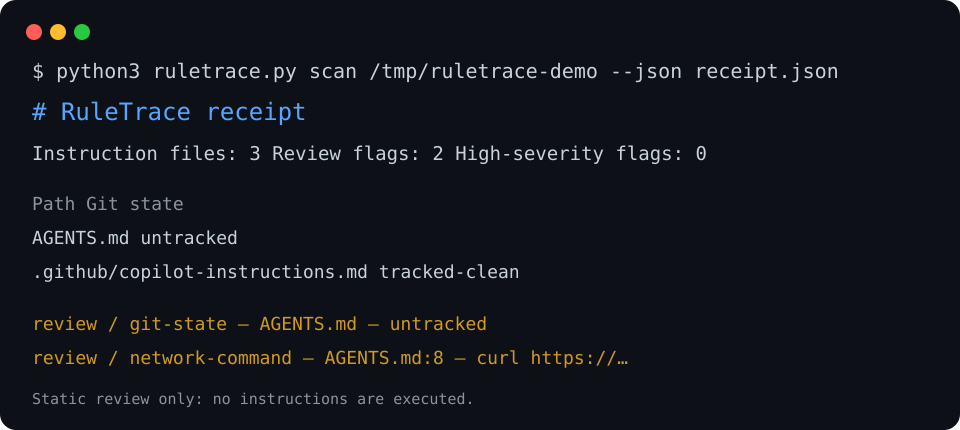

# RuleTrace

**A local, static receipt for the files that can steer a coding agent.**

RuleTrace inventories common agent instruction files, reports their Git state,
follows only explicit `@relative/path` references, and produces a reviewable
Markdown/JSON receipt. It never executes content from an instruction file.



## Why

`AGENTS.md`, `CLAUDE.md`, Copilot instructions, Cursor rules, and similar files
are part of an agent's operating context. Before you let an agent work in an
unfamiliar tree, RuleTrace gives you a concise answer to: which such files are
present, are they changed/untracked, and which exact lines deserve review?

## Quick start

Python 3 and Git are the only requirements.

```sh
python3 ruletrace.py scan /path/to/repository
python3 ruletrace.py scan . --json ruletrace-receipt.json
python3 ruletrace.py scan . --strict  # returns 2 when high-severity flags exist
python3 -m unittest discover -s tests -v
```

To recreate the terminal scenario shown above the README, run:

```sh
sh examples/make-demo.sh /tmp/ruletrace-demo
python3 ruletrace.py scan /tmp/ruletrace-demo --json receipt.json
```

## What it checks

- `AGENTS.md`, `AGENTS.override.md`, `CLAUDE.md`, `GEMINI.md`, `.cursorrules`
- `.github/copilot-instructions.md`, `.cursor/rules/*`, `.claude/rules/*`
- Local Git state: tracked clean, modified, staged, untracked, or ignored
- Explicit `@relative/path` references: resolved, missing, escaping, or cyclic
- Heuristic review prompts for destructive, network, install, and credential-like lines

The receipt intentionally stores path, line, category, and a short truncated
line only. No network call, model call, package install, or instruction command
is performed.

## Example output

```text
# RuleTrace receipt
- Instruction files: 3
- Review flags: 2
- High-severity flags: 0

- **review / git-state** — `AGENTS.md` — untracked
- **review / network-command** — `AGENTS.md:8` — curl https://…
```

## Limits

RuleTrace is a heuristic review aid—not a malware detector or security proof.
It does not emulate every vendor's instruction precedence/load order, parse
arbitrary Markdown links, or determine whether a matched command is harmful.
Treat its flags as prompts for a human reviewer.

## Project layout

```text
ruletrace.py        CLI implementation (standard library only)
tests/              fixture-based unit tests
assets/             reproducible terminal demonstration
reports/            research, plan, QA, release, and showcase receipts
```

## License

[MIT](LICENSE)
